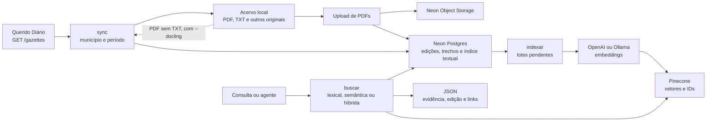
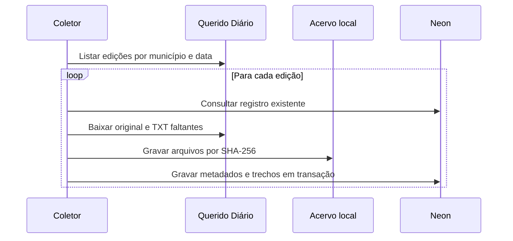

# Querido Diário · coleta e busca

Pipeline em Python 3.13 para guardar edições dos diários oficiais municipais,
baixar o arquivo original e o TXT quando disponíveis e pesquisar o acervo com
citações. O **Neon** guarda metadados e trechos pesquisáveis. Os arquivos ficam
no **acervo local**. Quando configurado, o **Neon Object Storage** também
recebe uma cópia dos PDFs. O **Pinecone** guarda vetores e referências aos trechos.

## Arquitetura



## Configuração

Execute os comandos abaixo a partir da raiz do projeto.

1. Rode `uv sync --locked` para instalar as versões de `uv.lock`.
2. Use `.env.example` como referência para complementar o `.env` existente.
   A busca lexical e a coleta exigem apenas `DATABASE_URL`, com uma conta do
   Neon autorizada a criar o esquema. Prefira a URL fornecida pelo Neon com TLS.
   Variáveis exportadas no terminal têm precedência sobre o `.env`.
3. Rode `uv run --locked python -m querido_diario init` para criar o esquema
   `querido_diario`. O comando pode ser repetido e `sync` também prepara o esquema.
4. Para a busca semântica, crie um índice **denso** no Pinecone e informe
   `PINECONE_INDEX_NAME` e `PINECONE_API_KEY`. Use métrica cosseno e a dimensão
   do modelo de embeddings. O padrão é OpenAI `text-embedding-3-small`,
   com 1536 dimensões. `OPENAI_MODEL_NAME` de chat não é usado para embeddings.
   Para usar Ollama, escolha `EMBEDDING_PROVIDER=ollama`, configure
   `OLLAMA_EMBEDDING_MODEL` e deixe o serviço rodando com esse modelo disponível.
   O índice precisa ter a dimensão correspondente.

## Painel local em Streamlit

Na raiz do projeto, instale as dependências e abra o painel:

```bash
uv sync --locked
uv run --locked python -m streamlit run app.py --server.address 127.0.0.1
```

Abra o endereço local indicado no terminal (normalmente
`http://127.0.0.1:8501`). O painel usa o mesmo `.env` e acervo da CLI.
Se um servidor já estava aberto, encerre-o com Ctrl+C e inicie novamente
com o comando acima. O painel usa o Python do `.venv` do projeto para
executar a CLI quando esse ambiente existe.

- **Coletar edições** aceita seleção múltipla das 27 capitais por nome ou
  código IBGE, códigos manuais para outros municípios e um período. Também aceita um manifesto JSON
  de até 5 MB. Você pode habilitar Docling e o envio de PDFs ao bucket.
- **Verificar cobertura** mostra o nome da capital quando conhecido, o código IBGE e a data da última publicação
  disponível no Querido Diário e quantos registros a fonte lista no período.
  Uma consulta válida com zero registros é exibida separadamente de erros HTTP
  ou de conexão. A consulta usa apenas a API pública e não grava no Neon.
  A data reflete o acervo da fonte, que pode estar defasado em relação à prefeitura.
  Pela CLI: `uv run --locked python -m querido_diario cobertura --municipio 3550308 --inicio 2026-11-01 --fim 2026-11-14`.
- **Enviar PDFs pendentes** copia os PDFs já coletados ao bucket, com filtros
  opcionais de município e datas.
- O painel mostra o registro durante a execução e o resumo ao final. Use
  **Interromper execução** para parar a tarefa. Os dados confirmados continuam
  disponíveis, e você pode repetir a operação para retomar o trabalho.

O painel é local, sem autenticação, e executa uma tarefa de cada vez por
servidor Streamlit. Deixe o servidor aberto durante a execução. O painel
mantém apenas a última execução, em arquivos temporários, sem histórico
persistente. A busca e a indexação no Pinecone continuam disponíveis na CLI.

## Coletar edições

Exemplo com Campinas (código IBGE 3509502). As datas são inclusivas e podem ser
ajustadas conforme a cobertura do município.

```bash
uv run --locked python -m querido_diario sync \
  --municipio 3509502 --inicio 2026-08-24 --fim 2026-08-28
```

Repita `--municipio` para incluir outras cidades. Para atualizar o acervo sem
informar datas, rode `sync --municipio 3509502 --dias 7`. Isso revisita a janela
recente, incluindo o dia atual em São Paulo. Para detectar edições históricas
adicionadas mais tarde, revisite períodos anteriores. Agende a execução no seu
ambiente se quiser uma coleta recorrente.

A API é paginada por município e dia. A coleta faz novas tentativas em falhas
transitórias, respeita um limite configurável de até 60 requisições por minuto e
grava cada edição em uma transação. Se houver falhas, consulte o resumo JSON e
os avisos em stderr. Uma saída com código 1 sinaliza falha operacional.
Respostas 404/410 de arquivos preservam os links no registro para nova tentativa.
A ausência de resultados para uma data pode refletir a cobertura da fonte.
Se a API de listagem estiver fora do ar, você pode importar um resultado de
`/gazettes` salvo anteriormente com
`uv run --locked python -m querido_diario sync --manifesto edicoes.json`.
O arquivo deve conter a lista `gazettes` do JSON da API, e o download ainda
depende de os links de arquivo estarem acessíveis.
O limite do manifesto é 5 MiB, tanto na CLI quanto no painel. A estrutura é
validada antes de preparar o esquema e o storage; registros inválidos são
contabilizados como falhas sem impedir o processamento dos demais.

Cada arquivo é identificado pelo SHA-256 dos bytes e gravado atomicamente em
`QD_ACERVO/objetos/`. Um original identificado pelo cabeçalho PDF recebe extensão
`.pdf`. Outros originais binários ficam em `.bin`. O Postgres guarda o caminho
relativo ao acervo, além da URL remota. Faça backup da pasta `QD_ACERVO` se
precisar preservar cópias locais. Se o arquivo mudar na fonte sem alteração
no checksum ou na URL de identidade, remova a cópia local e sincronize de novo.
Ao reutilizar arquivos, o pipeline confere o SHA-256 de PDFs e TXTs e rejeita
caminhos fora do acervo. Arquivos corrompidos são baixados novamente. Essa
verificação lê os arquivos locais e pode aumentar o tempo da sincronização.

O texto do Querido Diário tem preferência. Com `--docling`, a coleta tenta
extrair texto do PDF quando o TXT não está disponível. A primeira execução do
Docling pode baixar modelos. Uma edição sem texto ainda fica registrada com
seus metadados e links. Os resultados de busca apontam para a edição e a posição
do trecho no texto processado. Consulte o PDF para confirmar a página original.



## Enviar PDFs ao Neon Object Storage

Acrescente ao `.env` as credenciais do bucket do Neon: `AWS_ENDPOINT_URL_S3`,
`AWS_ACCESS_KEY_ID`, `AWS_SECRET_ACCESS_KEY` e `AWS_REGION`. Defina
`QD_STORAGE_BUCKET` com o nome do bucket já criado. Se a credencial permitir
listar buckets e houver exatamente um, o pipeline também consegue identificá-lo
sem essa variável. A credencial precisa permitir consultar metadados e gravar
objetos no destino. O pipeline usa HTTPS e endereçamento S3 por caminho.

Para enviar os PDFs de Goiânia que já estão no Mac, execute:

```bash
uv run --locked python -m querido_diario enviar-pdfs --municipio 5208707 --inicio 2026-11-01 --fim 2026-11-11
```

O comando usa os caminhos existentes no Postgres, sem chamar a API do Querido
Diário. Sem filtros, envia até 500 edições pendentes por execução. Ajuste com
`--maximo`. O comando aplica a migração de armazenamento automaticamente.
Após atualizar um banco existente, rode `init`, `sync` ou `enviar-pdfs` antes
de usar `buscar`.

Com as credenciais configuradas, `sync` também envia os PDFs automaticamente.
Use `sync --sem-storage` para coletar apenas no acervo local. No resumo de
`sync`, `pdfs` conta os PDFs locais e `pdfs_no_storage` conta os PDFs com
cópia remota confirmada, inclusive cópias já registradas. `falhas_storage`
conta problemas de envio e a edição permanece disponível para nova tentativa.

Os PDFs ficam no prefixo `querido-diario/pdf/`, com chave derivada do SHA-256.
O Postgres guarda endpoint, bucket, chave, checksum e horário de confirmação.
Se o upload concluir e a gravação no banco falhar, a próxima tentativa
reconhece o objeto pelo tamanho e SHA-256. O TXT e a cópia local do PDF continuam
no acervo. O pipeline mantém as permissões do bucket e devolve a referência
em vez de publicar o PDF ou gerar uma URL assinada.

## Indexar e buscar

```bash
# Busca local ao acervo do Neon, sem chamar um modelo.
uv run --locked python -m querido_diario buscar '"merenda escolar" OR alimentação' \
  --municipio 3509502 --inicio 2026-08-01 --limite 10

# Gravar até 500 vetores pendentes no Pinecone.
uv run --locked python -m querido_diario indexar --maximo 500

# Combinar termos e similaridade de significado.
uv run --locked python -m querido_diario buscar 'compra de alimentos para escolas' \
  --modo hibrida --municipio 3509502 --limite 10

# Substitua ID_DA_EDICAO pelo campo edicao_id devolvido por buscar.
uv run --locked python -m querido_diario edicao ID_DA_EDICAO
```

- **Lexical** usa busca textual do Postgres em português com índice GIN.
  Aspas pesquisam uma sequência de palavras e `OR` combina alternativas.
- **Semântica** gera um embedding da consulta e recupera trechos similares no
  Pinecone. O texto e as citações vêm do Neon.
- **Híbrida** combina as posições das duas buscas com Reciprocal Rank Fusion.
  É útil quando a consulta mistura expressões exatas e conceitos relacionados.

Cada resultado contém evidência, ID do trecho, município, data, edição, URLs
originais e caminhos no acervo. Um agente pode consumir o JSON de `buscar`,
usar a evidência para elaborar respostas e citar `url_original`. O comando
`edicao` retorna também o JSON integral da API, incluindo campos que não foram
mapeados em colunas.

A indexação é uma etapa separada para permitir coleta e busca textual sem gasto
com embeddings. Ela confirma os lotes no Neon depois do upsert no Pinecone. Se
a execução cair antes da confirmação, a próxima sobrescreve os mesmos IDs.
Cada combinação de provedor, modelo e dimensão usa um namespace derivado do
prefixo configurado. Se apagar ou recriar o índice no Pinecone, use um novo
`PINECONE_NAMESPACE` para reindexar. Quando o texto muda, o Neon troca os trechos
e ignora IDs antigos durante a recuperação. Esses vetores antigos podem
permanecer no Pinecone até a manutenção do namespace. Se usar OpenAI, o comando
`indexar` envia os trechos e a busca semântica envia a consulta à API de embeddings.

## Tabelas e código

Consulte o [dicionário de dados](docs/dicionario-de-dados.md) para ver todas as colunas do Neon, seus tipos, chaves e relacionamentos.

| Item | Responsabilidade |
| --- | --- |
| `querido_diario.edicoes` | Código IBGE, município, UF, datas, edição, indicador de edição extra, checksums, links, caminhos, formato e metadados da API em JSONB. |
| `querido_diario.trechos` | Texto em segmentos com sobreposição, posição na edição e índice textual. |
| `querido_diario.vetores` | Confirmações por trecho e configuração de indexação. |
| `querido_diario/__main__.py` | CLI, configuração, validação dos argumentos e saída JSON. |
| `querido_diario/fonte.py` | HTTP, paginação, retentativas e arquivamento atômico. |
| `querido_diario/coleta.py` | Identificação da edição, resolução dos arquivos, Docling e divisão do texto. |
| `querido_diario/banco.py` e `schema.sql` | Esquema, transações, persistência e busca lexical. |
| `querido_diario/storage.py` | Upload idempotente de PDFs e confirmação da referência remota. |
| `querido_diario/vetores.py` | Embeddings, indexação, recuperação e fusão de resultados. |
| `querido_diario/tipos.py` | Contratos de edições, filtros, resultados e conexão com o banco. |
| `querido_diario/capitais.py` | Catálogo local das capitais e rótulos para seleção no painel. |
| `app.py` | Interface Streamlit e controle do subprocesso da CLI. |

Valide a instalação com `uv run --locked python -m querido_diario --help`.
Para executar os testes sem serviços externos, rode
`uv run --locked python -m unittest discover -s tests -v`.

## Padrões e verificações de qualidade

Todas as funções, inclusive auxiliares privadas e testes, têm type hints e
docstrings em português. Funções simples usam uma descrição curta; funções
com contratos mais complexos documentam entradas, retornos, efeitos e erros.
Os contratos compartilhados ficam em `tipos.py`. Dados externos ainda precisam
ser validados em tempo de execução: type hints não validam o JSON recebido.

O `pyproject.toml` configura Ruff e mypy. Para executar as mesmas versões usadas
na revisão, com ferramentas isoladas do ambiente do pipeline:

```bash
uvx --from ruff==0.12.0 ruff check app.py querido_diario tests
uvx --from ruff==0.12.0 ruff format --check app.py querido_diario tests
uvx --from mypy==1.17.1 mypy --python-executable .venv/bin/python
uv run --locked python -m unittest discover -s tests -v
```

A primeira execução de `uvx` pode baixar as ferramentas. O mypy utiliza o Python
do projeto para localizar dependências e verifica os módulos de produção; Ruff
e os testes de padronização também cobrem os testes. Não é necessário alterar
as dependências do pipeline para executar essas ferramentas.

Os testes não acessam banco, bucket ou provedores de IA. Consulte a
[revisão técnica](docs/revisao-tecnica.md) para conhecer as falhas corrigidas,
o alcance da validação e as limitações operacionais.

Fonte dos dados: [Querido Diário, da Open Knowledge Brasil](https://queridodiario.org.br/sobre).
Consulte a [documentação da API pública](https://docs.queridodiario.ok.org.br/pt-br/latest/utilizando/api-publica.html)
e atribua a fonte ao reutilizar os dados, conforme as
[licenças do projeto](https://docs.queridodiario.ok.org.br/pt-br/latest/#licencas-termos-de-uso-e-politica-de-privacidade).
