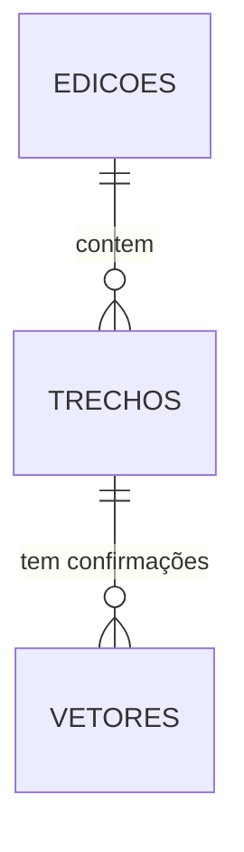

# Dicionário de dados

Este documento descreve o esquema `querido_diario` no Neon Postgres. A
definição das tabelas e a migração do Object Storage estão em
[querido_diario/schema.sql](../querido_diario/schema.sql). Os tipos abaixo
são os do PostgreSQL. `timestamptz` representa um instante e é exibido
no fuso horário da sessão do banco.

## `querido_diario.edicoes`

Uma linha por registro de edição coletado. Uma mesma data ou um mesmo número
de edição pode aparecer em mais de uma linha, por exemplo, quando os registros
apontam para arquivos com checksums diferentes.

| Coluna | Tipo | Aceita NULL? | Descrição |
| --- | --- | --- | --- |
| `id` | `text` | Não | Chave primária. SHA-256 calculado com código do município, data, número, indicador de edição extra e checksum da fonte, ou URL original quando o checksum da fonte está ausente. |
| `municipio_id` | `text` | Não | Código IBGE do município, armazenado como texto. |
| `municipio` | `text` | Não | Nome informado pela fonte. O código IBGE é usado como alternativa se faltar o nome. |
| `uf` | `text` | Sim | Sigla da unidade federativa informada pela fonte. |
| `publicada_em` | `date` | Não | Data de publicação da edição. |
| `coletada_na_fonte_em` | `timestamptz` | Sim | Instante em que o Querido Diário coletou a edição, conforme o campo `scraped_at`. |
| `numero` | `text` | Sim | Número ou identificador de edição informado pela fonte. É texto para preservar o formato original. |
| `extra` | `boolean` | Sim | Indicador de edição extra. `NULL` significa que a fonte não informou o indicador. |
| `checksum_fonte` | `text` | Sim | Checksum fornecido pelo Querido Diário, mantido como recebido. |
| `url_original` | `text` | Não | Link fornecido pelo Querido Diário para baixar o arquivo original da edição, que pode ser PDF ou outro formato. |
| `url_texto` | `text` | Sim | Link fornecido pelo Querido Diário para baixar o TXT da edição. |
| `metadados` | `jsonb` | Não | Registro da edição recebido na lista `gazettes`, incluindo os campos que também aparecem em colunas próprias. |
| `original_sha256` | `text` | Sim | SHA-256 calculado pelo pipeline a partir dos bytes do arquivo original baixado. |
| `original_caminho` | `text` | Sim | Caminho do arquivo original relativo à pasta `QD_ACERVO`. |
| `original_tipo` | `text` | Sim | Tipo atribuído ao original pelo pipeline. `application/pdf` identifica PDFs e `application/octet-stream` identifica os demais arquivos aceitos. |
| `original_bytes` | `bigint` | Sim | Tamanho do arquivo original baixado, em bytes. |
| `texto_sha256` | `text` | Sim | SHA-256 dos bytes do texto arquivado. |
| `texto_caminho` | `text` | Sim | Caminho do arquivo de texto relativo à pasta `QD_ACERVO`. |
| `texto_origem` | `text` | Sim | `querido_diario` para o TXT baixado da fonte ou `docling` para texto extraído localmente do PDF. |
| `pdf_disponivel` | `boolean` | Não na prática¹ | Coluna gerada e armazenada. É verdadeira quando `original_tipo` é `application/pdf`. Indica o formato do original registrado. |
| `atualizada_em` | `timestamptz` | Não | Instante de inserção ou da última atualização dos dados da edição pela coleta. O envio ao bucket tem seu próprio horário. Padrão `now()`. |
| `pdf_storage_endpoint` | `text` | Sim | Endpoint HTTPS do Object Storage que recebeu a cópia confirmada. |
| `pdf_storage_bucket` | `text` | Sim | Nome do bucket que recebeu a cópia confirmada. |
| `pdf_storage_key` | `text` | Sim | Chave do objeto no bucket, sob o prefixo `querido-diario/pdf/`. |
| `pdf_storage_sha256` | `text` | Sim | SHA-256 do PDF cuja cópia remota foi confirmada. |
| `pdf_storage_enviado_em` | `timestamptz` | Sim | Instante em que o pipeline registrou a confirmação da cópia remota. |

¹ A expressão usa `coalesce` e sempre produz `true` ou `false`, embora o
DDL não declare `NOT NULL` nessa coluna.

Para associar a cópia remota ao original atual, confirme que o bucket e a
chave estão preenchidos e que `pdf_storage_sha256 = original_sha256`.
O campo `pdf_disponivel` por si só não confirma a presença do arquivo no
bucket nem verifica se a cópia local ainda está no disco.

## `querido_diario.trechos`

Uma linha por trecho pesquisável de uma edição. Edições sem texto indexável
podem existir sem linhas nesta tabela.

| Coluna | Tipo | Aceita NULL? | Descrição |
| --- | --- | --- | --- |
| `id` | `text` | Não | Chave primária. SHA-256 calculado a partir do ID da edição, checksum do texto, versão do recorte e posição do trecho. Também é usado como ID do vetor no Pinecone. |
| `edicao_id` | `text` | Não | Chave estrangeira para `edicoes.id`. A exclusão da edição remove seus trechos em cascata. |
| `ordem` | `integer` | Não | Posição a partir de 1 no texto extraído da edição. Os trechos podem se sobrepor. A posição não é o número da página do PDF nem a numeração dos atos oficiais. |
| `texto` | `text` | Não | Conteúdo do trecho com espaços normalizados, usado como evidência e entrada para embeddings. |
| `busca` | `tsvector` | Não na prática² | Coluna gerada e armazenada a partir de `texto` com a configuração `pg_catalog.portuguese`. Sustenta a busca lexical pelo índice GIN. |

² O texto de origem é obrigatório e a expressão gera um `tsvector`, que
pode ser vazio. O DDL não declara `NOT NULL` nessa coluna.

A restrição `UNIQUE (edicao_id, ordem)` garante uma posição por edição.

## `querido_diario.vetores`

Uma linha por trecho com envio confirmado para um perfil de indexação.
Os valores numéricos dos embeddings ficam no Pinecone.

| Coluna | Tipo | Aceita NULL? | Descrição |
| --- | --- | --- | --- |
| `perfil` | `text` | Não | SHA-256 que identifica a combinação de host do índice Pinecone, namespace, provedor, modelo e dimensão dos embeddings. |
| `trecho_id` | `text` | Não | Chave estrangeira para `trechos.id`. A exclusão do trecho remove a confirmação no Postgres em cascata. |
| `indexado_em` | `timestamptz` | Não | Instante em que a confirmação do envio foi gravada no Postgres. Padrão `now()`. |

A chave primária é `(perfil, trecho_id)`, permitindo uma confirmação por
trecho em cada perfil. A exclusão de uma confirmação no Postgres não exclui
o vetor remoto.

## Relacionamentos

